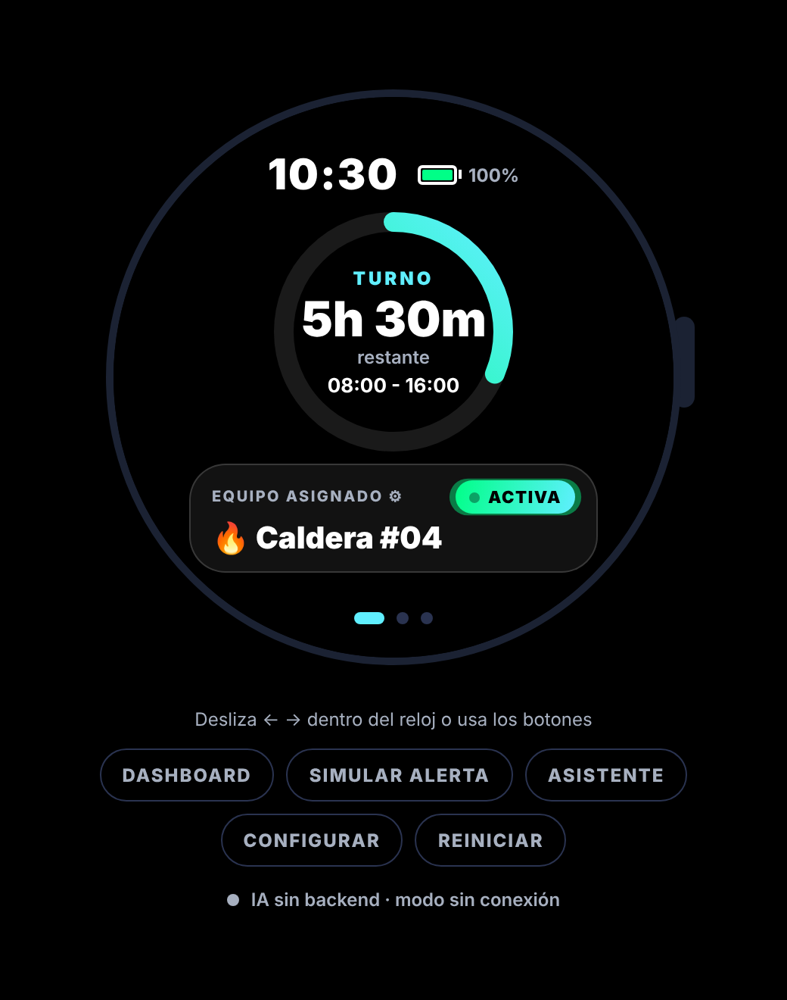
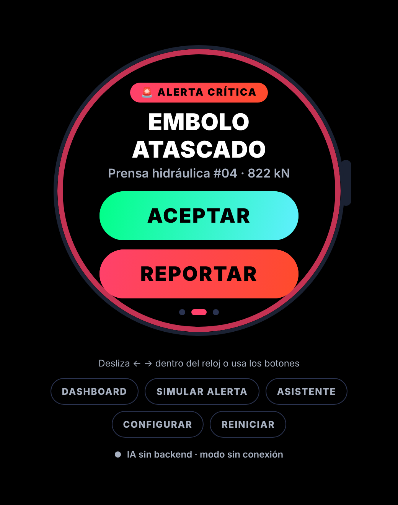
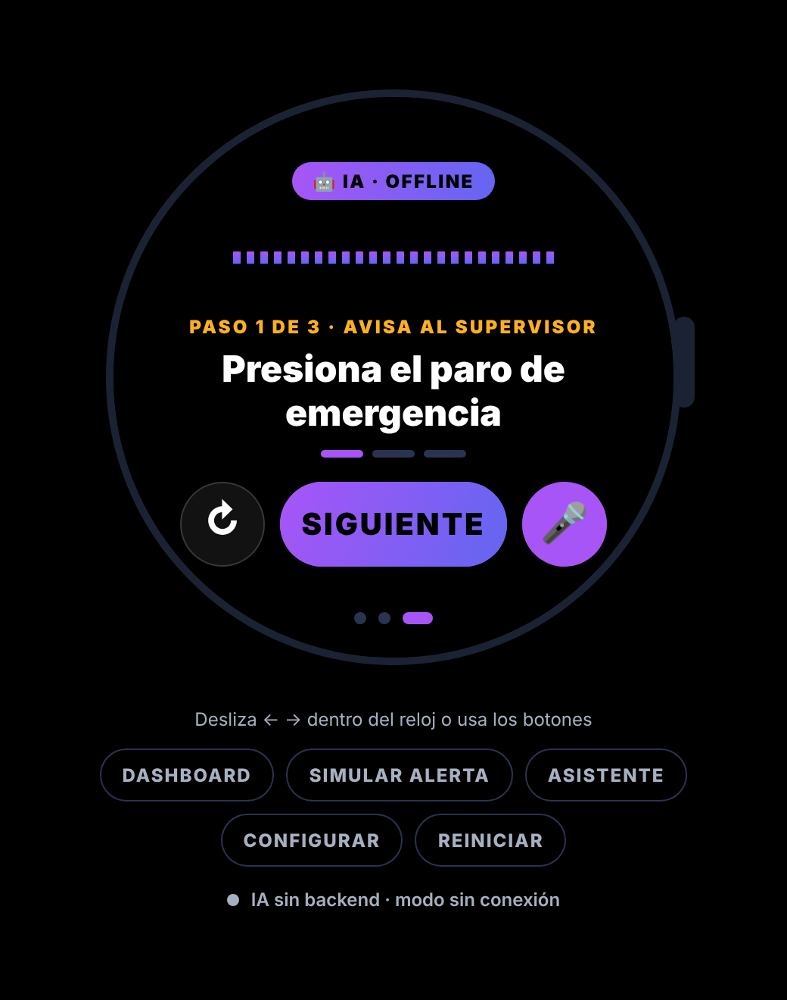
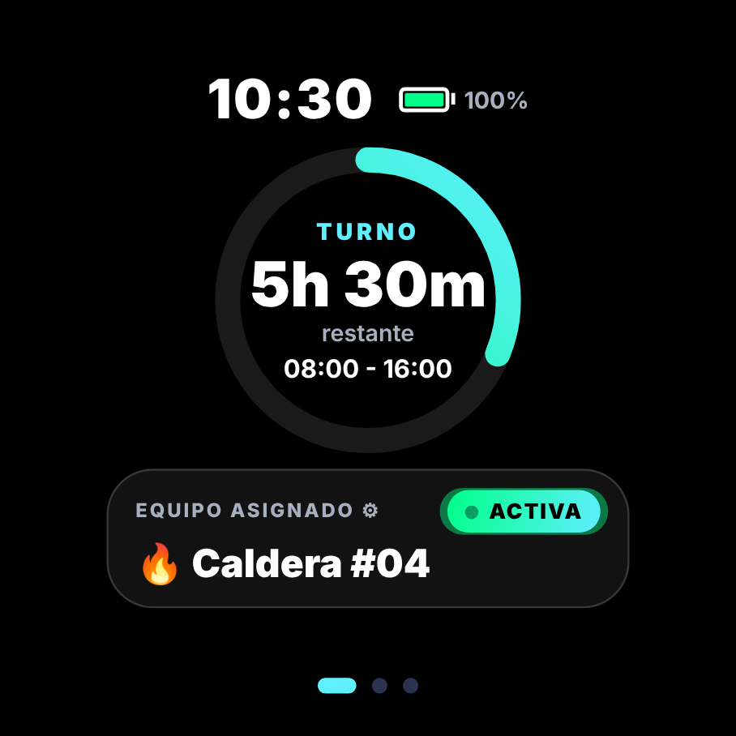

# WorkerWatch · Frontend

Aplicación **solo para smartwatch** pensada para trabajadores de planta: muestra el turno, avisa con alertas y vibración cuando algo falla en el equipo y, en una tercera pantalla, un **asistente de IA (Gemini) que guía la reparación por voz**. Proyecto final de _Diseño de interfaces_.

> Este repositorio es el **frontend** (Expo / React Native, publicado en Vercel como web y compilable a APK para Wear OS). El backend que conecta con Gemini está en [Proyectos-de-interfaces-SB](https://github.com/Juanda-11/Proyectos-de-interfaces-SB).

<p align="center">
  
  
  
  
</p>

## Qué hace

| Pantalla             | Descripción                                                                                                                                                                                          |
| -------------------- | ---------------------------------------------------------------------------------------------------------------------------------------------------------------------------------------------------- |
| **1 · Dashboard**    | Hora, batería real, anillo del turno (tiempo restante en tiempo real) y equipo asignado. **Toca el anillo o el equipo para configurarlos.**                                                          |
| **2 · Alerta IA**    | Borde pulsante, vibración según severidad (media / alta / crítica) y botones gigantes **ACEPTAR** / **REPORTAR**.                                                                                    |
| **3 · Asistente IA** | Plan de reparación paso a paso **hablado**. Puedes **preguntar o describir otro problema por voz o texto** ("la prensa hace un ruido metálico") y responde por voz.                                  |
| **Configuración**    | Tipo de equipo (10 tipos, varios sectores), número y nombre, turno (estándar, mañana, tarde, noche o personalizado, incluso nocturno), simulación automática de fallas y voz on/off. Se guarda sola. |

### Simulación (no hay máquina conectada)

Los sensores se simulan a partir de un catálogo: cada equipo tiene fallas con una lectura creíble (caldera → _Presión elevada · 12 bar_). Desde **Configuración → Simular falla** o con la simulación automática (cada 30 s, 2 min o 5 min) se dispara la alerta del equipo configurado. Sirve igual para una prensa, una cámara frigorífica o un monitor de signos vitales: el asistente se adapta al equipo.

### IA (Gemini) y modo sin conexión

La app llama al backend, que consulta a Gemini con reglas de seguridad laboral. Si no hay red, la cuota gratuita se agota o el backend no responde, **el asistente sigue funcionando** con los planes locales del catálogo (el chip muestra `IA · OFFLINE` en lugar de `IA · GEMINI`).

## Puesta en marcha

Requisitos: Node.js 20+.

```bash
npm install
cp .env.example .env     # EXPO_PUBLIC_API_URL=http://localhost:3001 si corres el backend local
npm run web              # abre el simulador en el navegador
```

Sin backend la app funciona completa en modo sin conexión. Para activar Gemini levanta el [backend](https://github.com/Juanda-11/Proyectos-de-interfaces-SB) y apunta `EXPO_PUBLIC_API_URL` a él. El panel bajo el reloj indica el estado ("IA conectada · gemini-…").

> En Android/iOS usa un _development build_ (no Expo Go) si quieres dictado por voz: `npx expo run:android`.

| Comando                   | Descripción                     |
| ------------------------- | ------------------------------- |
| `npm run web`             | Simulador en el navegador       |
| `npm run android`         | Dispositivo/emulador Android    |
| `npm test`                | Pruebas (Jest)                  |
| `npm run lint`            | ESLint                          |
| `npm run check`           | Lint + pruebas                  |
| `npm run build:web`       | Build estático en `dist/`       |
| `npm run build:apk:watch` | APK en modo reloj con EAS Build |

## Variables de entorno

| Variable                 | Descripción                                                                                            |
| ------------------------ | ------------------------------------------------------------------------------------------------------ |
| `EXPO_PUBLIC_API_URL`    | URL del backend. Vacía = modo sin conexión. Se incrusta al compilar.                                   |
| `EXPO_PUBLIC_WATCH_MODE` | `true` = pantalla completa sin marco ni controles de demo (APK del reloj). En web también: `?watch=1`. |

## Despliegue y reloj físico

- **Vercel (web):** [`docs/DESPLIEGUE.md`](docs/DESPLIEGUE.md) — backend primero, luego frontend con `EXPO_PUBLIC_API_URL`.
- **Smartwatch real (Wear OS):** [`docs/RELOJ_FISICO.md`](docs/RELOJ_FISICO.md) — APK en modo reloj, instalación por ADB, emulador y qué verificar en el dispositivo.
- **Arquitectura:** [`docs/ARQUITECTURA.md`](docs/ARQUITECTURA.md).

## Tecnología

Expo SDK 58 · React Native 0.88 · react-native-web · react-native-svg · expo-speech · expo-speech-recognition · expo-haptics · expo-battery · Jest + Testing Library · ESLint + Prettier · GitHub Actions.

## Diseño

Estilo _Cyber-Industrial Premium_: fondo negro OLED, degradados neón (verde = seguro, rojo = alerta, púrpura = IA), botones táctiles grandes (≥ 56 px), glow según el estado y una interfaz diseñada sobre una pantalla circular de 380 px que se escala a cualquier reloj. Tokens en [`src/theme/tokens.js`](src/theme/tokens.js).

## Limitaciones

- Probada en navegador y con pruebas automáticas; **no se ha probado en un reloj físico** (ver la guía).
- La lectura de sensores es simulada. Conectar una máquina real solo exige reemplazar `createSimulatedAlert` en `src/utils/faults.js`.
- La IA es una ayuda y no sustituye los procedimientos oficiales de seguridad y mantenimiento.
