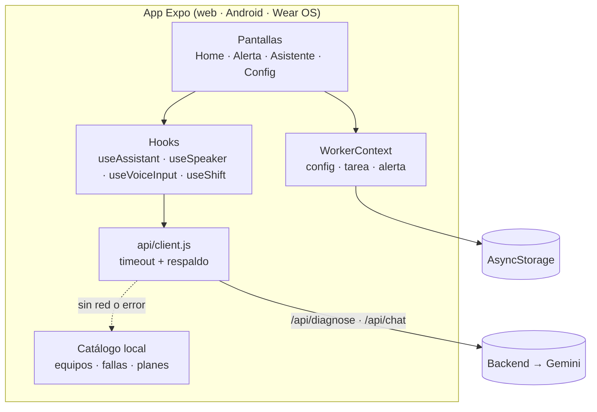
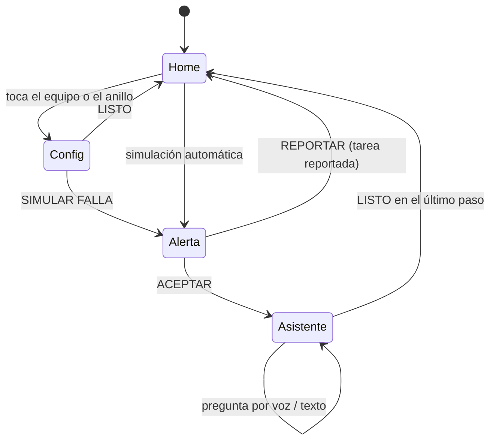

# Arquitectura del frontend

## Visión general



## Flujo de uso



## Decisiones de diseño

**Simulación configurable.** No hay máquina real, así que la alerta se genera a partir del catálogo (`src/data/machineTypes.js`): cada tipo de equipo tiene fallas con una magnitud y un rango (p. ej. caldera → 92–105 °C). El trabajador elige equipo, número, nombre y turno; la simulación puede ser manual o automática cada 30 s / 2 min / 5 min. Cambiar `createSimulatedAlert` por una lectura MQTT o REST de un PLC es el único punto que habría que tocar para conectar una máquina real.

**Sirve para más que máquinas.** El catálogo incluye sectores como logística, alimentos y salud (monitor de signos vitales, cámara frigorífica). Agregar un equipo es agregar un objeto al catálogo; los tests validan su forma.

**Turno real.** `utils/shift.js` calcula progreso y tiempo restante con la hora del dispositivo y soporta turnos nocturnos que cruzan la medianoche. Fuera de turno el anillo se apaga y muestra cuánto falta para empezar.

**La IA nunca deja al trabajador sin respuesta.** `api/client.js` intenta el backend (15 s de timeout); ante cualquier error devuelve el plan local del catálogo o, si el texto no coincide con ninguna falla, un procedimiento general de seguridad. El chip del asistente indica el origen (`IA · GEMINI` / `IA · OFFLINE`).

**Voz de entrada y salida.**

- Salida: `expo-speech` (TTS del sistema) con cancelación y temporizador de respaldo (`useSpeaker`).
- Entrada: `expo-speech-recognition` (Web Speech API en navegador, reconocedor nativo en Android). Se carga con `require` protegido: si el módulo nativo no existe (Expo Go) o el navegador no lo soporta, la interfaz ofrece teclado y atajos de fallas.

**Lógica separada de la vista.** `useAssistant` concentra el estado del asistente (idle → thinking → steps), cancela peticiones en vuelo al salir de la pantalla y se prueba sin renderizar UI.

**Modo reloj.** `EXPO_PUBLIC_WATCH_MODE=true` (o `?watch=1`) quita el marco y los controles de demostración y escala la interfaz de 380 px a la pantalla real.

## Estructura

```
App.js                  Navegación, gestos, botón atrás, simulación automática
src/
  api/client.js         Cliente del backend con respaldo local
  components/           Anillo de turno, tarjetas, botones, onda de voz, marco del reloj…
    config/             Stepper, OptionRow, SectionTitle
  context/              Estado global (reducer validado + persistencia)
  data/                 Catálogo de equipos y turnos predefinidos
  hooks/                useAssistant, useSpeaker, useVoiceInput, useShift, useBattery…
  screens/              Home, Alert, Assistant, Config
  theme/tokens.js       Colores y degradados (Cyber-Industrial)
  utils/                Cálculo de turno, fallas simuladas, háptica, modo reloj
__tests__/              Jest: turnos, catálogo, config, cliente, hook y pantallas
```

## Límites conocidos

- La batería real depende del dispositivo; en navegadores sin Battery API se muestra un valor de demostración.
- El reconocimiento de voz del navegador no existe en Firefox.
- No hay autenticación de dispositivo: el backend se protege con CORS, validación y límite de peticiones.
